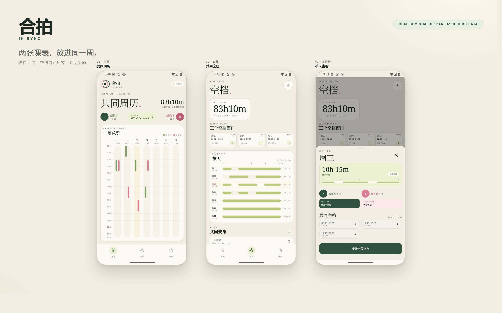
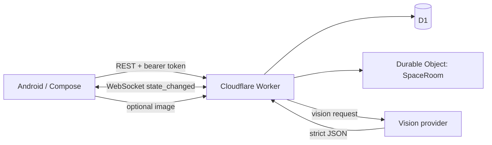

# Hepai / 合拍

A small, self-hostable **two-person timetable merge** framework:

- Android client built with Kotlin + Jetpack Compose
- Cloudflare Worker + D1 + Durable Object backend
- Optional image → vision-model → reviewed JSON OCR flow
- Weekly merge, common-free-time calculation, shared plans
- REST versioning plus WebSocket notifications

> This is a **sanitized framework**, not the authors' private deployment.
> It contains no real names, invite codes, account IDs, timetable screenshots,
> private schedules, API keys, or release APKs.



The preview above is captured from the actual Compose code using the debug-only
`DemoActivity` and generic demo data. It is not a redrawn mockup.

[](https://github.com/Xinghao2006/hepai/actions/workflows/android.yml)
[](https://github.com/Xinghao2006/hepai/actions/workflows/backend.yml)


## Why

Two people often have separate timetable screenshots. This framework turns them
into one shared week, shows the time both are free, and keeps shared plans in
sync. The OCR flow is optional and always passes through a review screen before
timetable JSON is saved.

## Architecture



More detail: [docs/ARCHITECTURE.md](docs/ARCHITECTURE.md).

## Quick start

### Android

Requirements: JDK 17, Android SDK 35, Gradle 8.7 (wrapper included).

```bash
cd android
./gradlew :app:assembleDebug
```

Set your Worker origin in:

```text
android/app/src/main/java/com/example/hepai/data/ApiClient.kt
```

`BindingConfig.kt` is blank by default, so the generic create/join/rejoin
onboarding flow is used.

### Backend

```bash
cd backend
npm ci
npx wrangler d1 create shared-timetable
# put the returned database_id into wrangler.toml
npx wrangler d1 execute shared-timetable --remote --file=./schema.sql
npx wrangler secret put DEEPSEEK_API_KEY
npx wrangler deploy
```

The OCR integration is an example. See [docs/API.md](docs/API.md) and
[docs/PRIVACY.md](docs/PRIVACY.md) before deploying it with real data.

## Configuration

| Where | What |
|---|---|
| `android/.../ApiClient.kt` | Worker base URL and fallback |
| `android/.../BindingConfig.kt` | Optional private-build binding; blank = generic |
| `backend/wrangler.toml` | D1 binding, Worker name, compatibility date |
| `backend/src/config.js` | Roles, example slots, OCR model/max tokens |
| `backend/src/ocr.js` | Vision prompt and JSON contract |
| `backend/src/validation.js` | Accepted day/time/name rules |

## Tests

```bash
cd backend && npm ci && npm test
cd android && ./gradlew :app:ktlintCheck :app:testDebugUnitTest
```

The repository includes unit tests for course normalization and the Worker's
JSON validation. The OCR provider call itself needs a real key and is not run in
CI.

## Repository layout

```text
android/                  Android app
backend/                  Worker, D1 schema, tests
docs/API.md               HTTP/WebSocket contract
docs/ARCHITECTURE.md      module and data-flow map
docs/PRIVACY.md           data handling notes
docs/screenshots/         sanitized UI preview
.github/                  CI, issue/PR templates
```

## Limitations

- OCR is example code and depends on a third-party vision provider.
- The example period slots are generic; replace them for your school.
- No push notifications; the client uses WebSocket plus a polling fallback.
- This is a framework, not a hosted service. You supply D1, secrets, domain,
  consent, retention, and rate limiting. The example does not include a
  production rate limiter; put Cloudflare Rate Limiting/WAF in front of a public
  deployment.
- Never commit private timetable images or real invite/space tokens.

## Contributing

See [CONTRIBUTING.md](CONTRIBUTING.md), [SECURITY.md](SECURITY.md), and
[CODE_OF_CONDUCT.md](CODE_OF_CONDUCT.md).

## License

The project code and documentation are MIT-licensed. See [LICENSE](LICENSE),
[COPYRIGHT.md](COPYRIGHT.md), [THIRD_PARTY_NOTICES.md](THIRD_PARTY_NOTICES.md),
and the full texts in [LICENSES](LICENSES/). The project name and logo are not
trademark-cleared; see [TRADEMARKS.md](TRADEMARKS.md) before commercial use.
