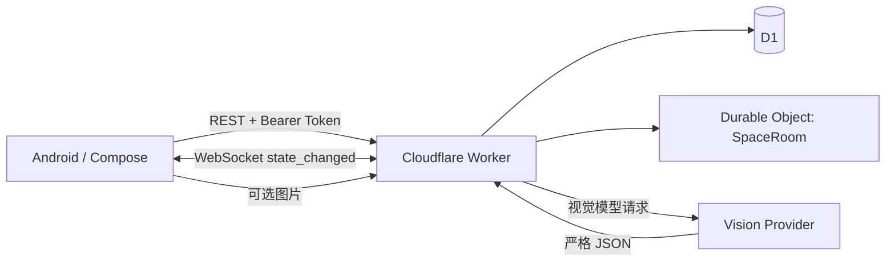

# Hepai / 合拍

[中文](README.md) | [English](README.en.md)

一个可自托管、供两个人使用的**课表合并框架**：

- Android 客户端：Kotlin + Jetpack Compose
- 后端：Cloudflare Worker + D1 + Durable Object
- 可选的图片 OCR：图片 → 视觉模型 → 审核后的 JSON
- 周历合并、共同空档计算、共同安排
- REST 版本号同步 + WebSocket 通知

> 这是一个**脱敏后的框架**，不是作者的私人部署版本。
> 仓库不包含真实姓名、邀请码、账号 ID、真实课表截图、私人课表、API Key 或 Release APK。


上面的预览来自实际 Compose 代码：通过 debug-only 的 `DemoActivity` 和通用演示数据运行并截图，不是重绘稿。


## 为什么做这个

两个人通常各自有一张课表截图。这个框架把两张课表放进同一周，显示双方共同空闲的时间，并同步共同安排。OCR 流程是可选的，而且识别结果必须先经过确认页，确认后才会保存为课表 JSON。

## 架构



更详细说明见 [docs/ARCHITECTURE.md](docs/ARCHITECTURE.md)。

## 快速开始

### Android

环境要求：JDK 17、Android SDK 35、Gradle 8.7（已带 wrapper）。

```bash
cd android
./gradlew :app:assembleDebug
```

部署前修改 Worker 地址：

```text
android/app/src/main/java/com/example/hepai/data/ApiClient.kt
```

`BindingConfig.kt` 默认是空的，因此会使用通用的创建/加入/重入流程。

### 后端

```bash
cd backend
npm ci
npx wrangler d1 create shared-timetable
# 把返回的 database_id 填进 wrangler.toml
npx wrangler d1 execute shared-timetable --remote --file=./schema.sql
npx wrangler secret put DEEPSEEK_API_KEY
npx wrangler deploy
```

OCR 是示例集成。用真实数据部署前请阅读 [docs/API.md](docs/API.md) 和
[docs/PRIVACY.md](docs/PRIVACY.md)。

## 配置项

| 位置 | 作用 |
|---|---|
| `android/.../ApiClient.kt` | Worker 主地址和回退地址 |
| `android/.../BindingConfig.kt` | 可选私人构建绑定；留空则使用通用流程 |
| `backend/wrangler.toml` | D1 binding、Worker 名称、compatibility date |
| `backend/src/config.js` | 成员角色、示例节次、OCR 模型和 token 上限 |
| `backend/src/ocr.js` | 视觉模型提示词和 JSON 契约 |
| `backend/src/validation.js` | 星期、时间、课程名校验 |

## 测试

```bash
cd backend && npm ci && npm test
cd android && ./gradlew :app:ktlintCheck :app:testDebugUnitTest
```

仓库包含课程名归一化和 Worker JSON 校验的单元测试。OCR 的真实模型调用需要 Key，不在 CI 中运行。

## 目录结构

```text
android/                  Android 应用
backend/                  Worker、D1 schema、测试
docs/API.md               HTTP/WebSocket 接口说明
docs/ARCHITECTURE.md      模块与数据流
docs/PRIVACY.md           数据处理说明
docs/screenshots/         脱敏 UI 预览
.github/                  CI、Issue/PR 模板
```

## 已知限制

- OCR 是示例代码，依赖第三方视觉模型服务。
- 示例节次是通用数据；换学校/场景请改 `config.js`。
- 没有推送通知；客户端使用 WebSocket + 轮询兜底。
- 这是一个框架，不是托管服务。D1、Secret、域名、用户同意、数据保留和限流都由部署者负责。
- 示例没有生产级限流；公开部署前请配合 Cloudflare Rate Limiting/WAF。
- 不要提交私人课表截图、真实邀请码或真实空间 token。

## 参与贡献

见 [CONTRIBUTING.md](CONTRIBUTING.md)、[SECURITY.md](SECURITY.md) 和
[CODE_OF_CONDUCT.md](CODE_OF_CONDUCT.md)。

## 许可证

项目代码和文档使用 MIT License。见 [LICENSE](LICENSE)、
[COPYRIGHT.md](COPYRIGHT.md)、[THIRD_PARTY_NOTICES.md](THIRD_PARTY_NOTICES.md)
以及 [LICENSES](LICENSES/) 中的完整第三方许可证文本。项目名称和 Logo 未做商标检索，
商业使用前请阅读 [TRADEMARKS.md](TRADEMARKS.md)。
