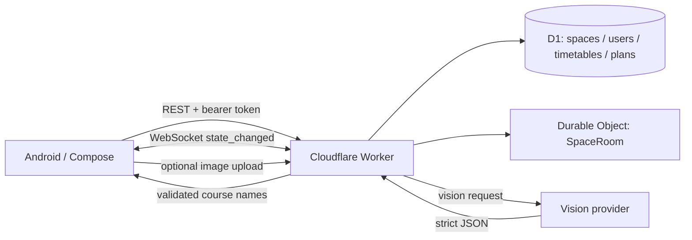

# Architecture

## Android

- `MainViewModel`: boot, auth, state, OCR, plans, polling/socket.
- `ApiClient`: REST + WebSocket, primary/fallback base URLs.
- `ScheduleLogic`: busy intervals, common free windows, overlap.
- `TimetableUpload`: optional day-column composition for OCR.
- `CourseLexicon`: conservative local name normalization.
- Compose screens: week, free time, day detail, import, OCR review.

## Worker

- `src/index.js`: routes, auth, space, timetable, plans, WebSocket.
- `src/http.js`: CORS, JSON responses, body parsing.
- `src/config.js`: roles, example slots, OCR/model settings.
- `src/validation.js`: loose JSON parsing and course validation.
- `src/ocr.js`: image request, JSON repair retry, validated response.
- `src/room.js`: Durable Object notification fan-out.

## Data flow

1. Device bootstraps a token.
2. A member creates or joins a two-person space.
3. Each person uploads a timetable; the optional OCR result is reviewed before
   `POST /v1/timetable`.
4. The Worker bumps the space version and notifies the Durable Object.
5. Peers refresh over WebSocket or the polling fallback.
6. Free-time windows are computed from both timetable arrays.

## Design boundaries

- The backend is the source of truth for shared space state.
- The Android client keeps a last-known snapshot for offline display.
- OCR is optional and example-only; it is not a trusted source of times.
- Personal screenshots and private schedules are intentionally not in this
  framework.
